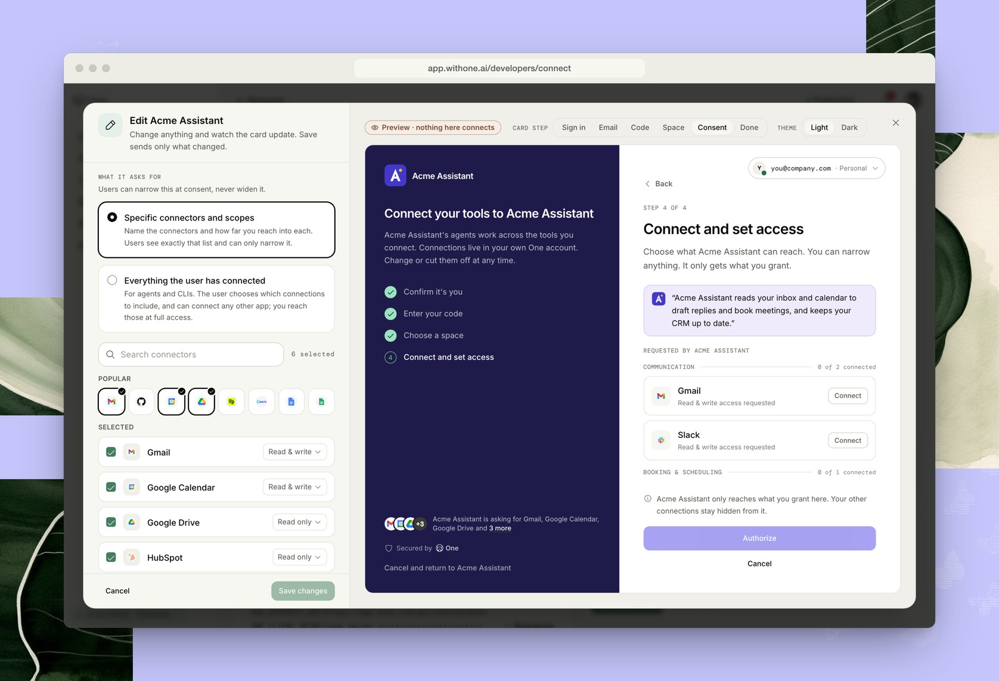
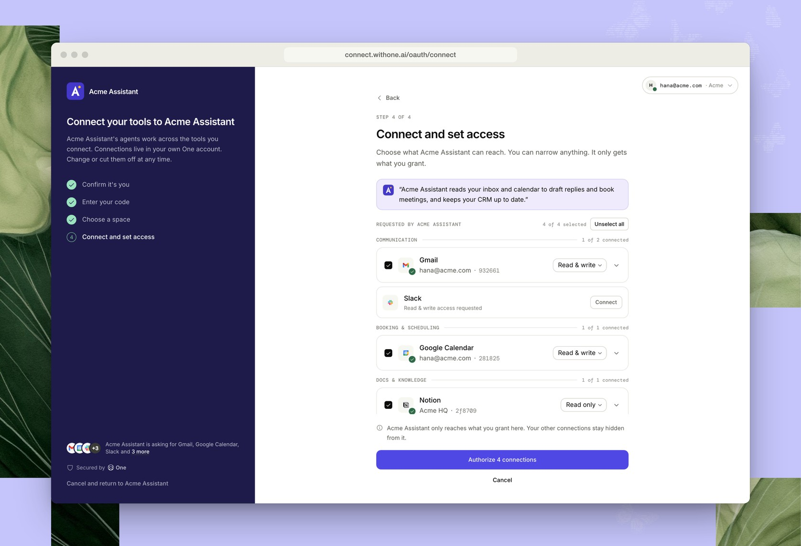
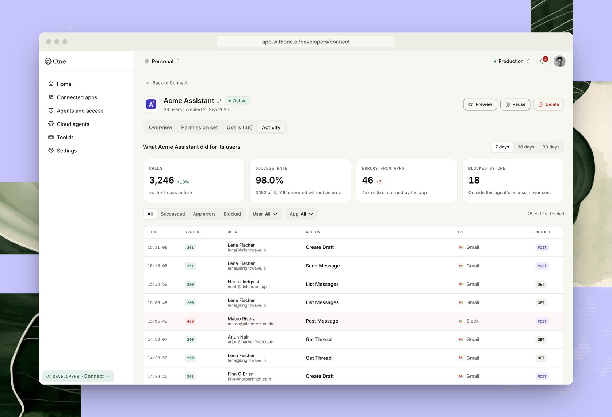

<p>
  <a href="https://withone.ai/products/connect">
    <picture>
      <source media="(prefers-color-scheme: dark)" srcset="https://raw.githubusercontent.com/withoneai/connect/main/assets/banner-dark.svg">
      
    </picture>
  </a>
</p>

<h3 align="center">One Connect</h3>

<p align="center">
  <a href="https://withone.ai/docs/connect"><strong>Docs</strong></a>
  &nbsp;&middot;&nbsp;
  <a href="https://withone.ai/docs/connect/reference"><strong>Reference</strong></a>
  &nbsp;&middot;&nbsp;
  <a href="https://tryconnect.forkable.dev"><strong>Live demo</strong></a>
  &nbsp;&middot;&nbsp;
  <a href="https://app.withone.ai/developers/connect"><strong>Dashboard</strong></a>
  &nbsp;&middot;&nbsp;
  <a href="https://github.com/withoneai/connect/blob/main/CHANGELOG.md"><strong>Release notes</strong></a>
</p>

<p align="center">
  <a href="https://npmjs.com/package/@withone/connect"></a>
  &nbsp;
  <a href="https://withone.ai/knowledge"></a>
  &nbsp;
  <a href="https://withone.ai/knowledge"></a>
  &nbsp;
  <a href="https://github.com/withoneai/connect/blob/main/LICENSE"></a>
</p>

One Connect is One's embeddable authentication for your product. Add it, and each of your users connects their own Gmail, Slack, Notion, Stripe or any other app on One's hosted page, chooses how much your product can reach, and can take it back at any time. Sign-in, consent, credential storage, refresh and the check on every call all run on One's&nbsp;side.

In your product it is a button and two backend routes. Your server keeps one key for the app and one short id for each user, and it never holds a provider&nbsp;credential.

Connect is free on every&nbsp;plan.

## Quick start

### With your agent

Install the Connect skill in your app's repo, then hand the rest to your coding&nbsp;agent.

```bash
npx skills add withoneai/connect
```

Then send your agent this&nbsp;message.

```text
Use the one-connect skill to add One Connect to this app
```

Your agent installs `@withone/connect`, describes your app in `one.connect.ts` and runs `one connect create`, which opens your browser. You approve the app there, as your users will see it, and copy its two secrets into your env file. They are made on that page and shown once, which keeps them out of the terminal and the chat. Then the agent wires the two routes, the button and the calls. If the One CLI is not on your machine yet, the skill tells your agent how to install it and sign you&nbsp;in.

Already made the app in the dashboard? Its page has the same install command and a prompt with your app's ids under **Hand it to your&nbsp;agent**.

The skill lives in [`skills/one-connect`](https://github.com/withoneai/connect/tree/main/skills/one-connect) and ships inside the&nbsp;package.

### By hand

```bash
npm install @withone/connect
```

**1. Create your app.** In the dashboard, go to **Developers → Connect → New app**, register your callback URL and choose what the app asks for. The card your users will see sits beside it and updates as you&nbsp;choose.

<p>
  
</p>

Or describe the app in `one.connect.ts` and run `one connect create` with the [One CLI](https://github.com/withoneai/cli). Either way you end up with&nbsp;these.

```env
ONE_CLIENT_ID=…
ONE_CLIENT_SECRET=one_secret_…                         # server only
ONE_CONNECT_KEY=sk_live_…                              # server only
ONE_REDIRECT_URI=https://yourapp.com/api/one/callback  # exactly the registered URL
ONE_PERMISSION_SET=…                                   # optional, what the app asks for
```

**2. Create the server client.** `userId` is your app's own id for the user. `reference` is one short string to save in a column and hand back&nbsp;unchanged.

```ts
// lib/one.ts  (server only)
import { createOneConnect } from "@withone/connect/server";

export const oneConnect = createOneConnect({
  clientId: process.env.ONE_CLIENT_ID!,
  clientSecret: process.env.ONE_CLIENT_SECRET!,
  redirectUri: process.env.ONE_REDIRECT_URI!,
  permissionSet: process.env.ONE_PERMISSION_SET,
  connectKey: process.env.ONE_CONNECT_KEY!,
  userStore: {
    saveUser: (userId, reference) => db.users.update(userId, { oneConnect: reference }),
    loadUser: async (userId) => (await db.users.find(userId))?.oneConnect ?? null,
    clearUser: (userId) => db.users.update(userId, { oneConnect: null }),
  },
});
```

**3. Mount the two routes.** This file serves `/api/one/authorize` and `/api/one/callback`. `identifyUser` returns the id of your own signed-in&nbsp;user.

```ts
// app/api/one/[action]/route.ts   (Next.js App Router)
import { createOneConnectRoutes } from "@withone/connect/next";
import { oneConnect } from "@/lib/one";

export const { GET } = createOneConnectRoutes(oneConnect, {
  identifyUser: async (request) => (await getSession(request))?.userId ?? null,
  signInUrl: "/login",
});
```

Remix, SvelteKit, Hono and Bun pass their own web `Request` to the same `GET`. For Express, Fastify, Koa or plain Node, `createOneConnectHandlers` from `@withone/connect/node` returns `{ authorize, callback }` to mount on those two&nbsp;paths.

**4. Add the&nbsp;button.**

```tsx
import { ConnectButton } from "@withone/connect/react";

<ConnectButton
  authorizeUrl="/api/one/authorize"
  logos={["gmail", "google-calendar", "stripe"]}
  connected={user.hasOneGrant}   // from your server: await oneConnect.isConnected(userId)
  onSuccess={() => refresh()}
/>
```

**5. Call One with the&nbsp;grant.**

```ts
const connections = await oneConnect.listConnections(userId);
const stripe = connections.find((c) => c.platform === "stripe");
const [action] = await oneConnect.searchActions(userId, "stripe", "list invoice items");

const reply = await oneConnect.runAction(userId, {
  connectionKey: stripe.key,
  actionId: action._id,
  body: { limit: 10 },
});
// { status, ok, blockedByGrant, refusal, rateLimit, data }
```

The docs take each step further. See [Create your app](https://withone.ai/docs/connect/create), [Add it to your product](https://withone.ai/docs/connect/integrate) and [Use the&nbsp;grant](https://withone.ai/docs/connect/use).

## How it works

```
Browser                    Your server                          One
<ConnectButton>  ──────►   GET /api/one/authorize  ──302──►  One's page (sign in, set access)
                           GET /api/one/callback   ◄──302──  ?code&state
                             saves the grant for the user, redirects home
onSuccess()      ◄──────
later:                     oneConnect.runAction(userId, …)  ──►  One, grant enforced
or, for your own agent:    oneConnect.getMcpToken(userId)   ──►  a bearer for One's MCP server
                           or the One CLI with your connect key and the user's id
```

- **You choose what to ask for.** Name the apps and set read only, read and write, full access or exact actions for each, in the dashboard or in `one.connect.ts`. An agent that works across whatever its users have can ask for everything&nbsp;instead.
- **Your user decides what to give.** Every app you asked for shows with its level. They can narrow any of them before they authorize, and never widen&nbsp;one.
- **One does the rest.** The connections stay in your user's One account. One attaches the credential on its side when an action runs and checks the grant on every&nbsp;call.

## What your users see

The button sends the browser to One's hosted page, in your name and your colours. Your user confirms their email with a six digit code, picks a space if they belong to an organization, then sets the access for each app. A missing app connects right there in the&nbsp;flow.

<p>
  
</p>

They can change a level, add another account or turn an app off later from your product or from their One dashboard, and One applies it on the next call. See [What your users see](https://withone.ai/docs/connect/consent) and [Manage users and&nbsp;access](https://withone.ai/docs/connect/manage).

## What you can build

### A button that looks like yours

`ConnectButton` comes for React and Vue, as a Svelte action and as the `<one-connect-button>` web component. It has three variants, three sizes, a light and a dark theme, and it takes your brand&nbsp;colour.

```tsx
<ConnectButton authorizeUrl="/api/one/authorize" label="Connect your tools" accent="#F4A938" />
```

The flow is a full page redirect to your authorize route, which means any element can start it. Keep your own design system button and wire the flow to&nbsp;it.

```tsx
import { useOneConnect } from "@withone/connect/react";

const { open, status } = useOneConnect({
  authorizeUrl: "/api/one/authorize",
  onSuccess: () => refresh(),
});

<button onClick={open} disabled={status === "connecting"}>Connect your tools</button>
```

| You&nbsp;want | Use |
|---|---|
| Your own button in&nbsp;React | `useOneConnect` from&nbsp;`@withone/connect/react` |
| Your own button in any framework, or&nbsp;none | `createConnectFlow` from&nbsp;`@withone/connect` |
| No SDK in the&nbsp;browser | A plain link to your authorize&nbsp;route |
| One app connected now, from a chat or a settings&nbsp;row | `openApp: "gmail"`, with `returnTo` for the page to come back&nbsp;to |
| A Manage button for each app the user&nbsp;granted | `listConnections`, then `openApp` for each&nbsp;app |

See [Add it to your product](https://withone.ai/docs/connect/integrate) for every prop and&nbsp;state.

### Calls that stay inside the grant

Work the way the One CLI does. Find the action, read its knowledge, run it. `getActionKnowledge` returns the action's guide with every field it takes, and `runAction` takes the method and path from the action, fills the path's placeholders and adds One's&nbsp;headers.

One judges every action by what it does to the user's data, never by its HTTP method. A read only grant runs a search that is sent as a POST and refuses a GET that changes something. A call outside the grant never reaches the&nbsp;provider.

| `refusal` | Status | What&nbsp;happened |
|---|---|---|
| `"grant"` | `403` | The call is outside what the user granted. Don't retry&nbsp;it |
| `"plan_limit"` | `402` | Your One plan is at its monthly limit, counted across all your users. It is not the&nbsp;grant |
| `"rate_limit"` | `429` | Too many calls. Wait `rateLimit.retryAfter`&nbsp;seconds |
| `"one_error"` | other | Retry with a&nbsp;backoff |
| `null` | any | The provider's own answer, or a&nbsp;success |

See [Use the grant](https://withone.ai/docs/connect/use) for the full call shapes, rate limits and&nbsp;errors.

### Your own agent, acting as the user

If your product runs its own AI agent, hand it the user's grant and let it find and run actions itself. It reaches exactly what the user granted, at the same&nbsp;levels.

```ts
const { accessToken, url } = await oneConnect.getMcpToken(userId);
// url is https://mcp.withone.ai/mcp. Give both to your agent's MCP client,
// Streamable HTTP, with the header  Authorization: Bearer <accessToken>
```

| | One's MCP&nbsp;server | The One&nbsp;CLI |
|---|---|---|
| Your agent&nbsp;gets | A bearer for one user, for 15 minutes in key&nbsp;mode | `one list` and `one actions`, run as the&nbsp;user |
| Your server&nbsp;sets | Nothing&nbsp;more | `ONE_SECRET` and `ONE_CONNECT_USER_ID` for each&nbsp;run |
| Fits | An agent with an MCP client, or one that needs a raw&nbsp;shell | An agent that calls tools as&nbsp;commands |
| Works&nbsp;in | Key mode and token&nbsp;mode | Key mode&nbsp;only |

See [Give your agent the MCP server](https://withone.ai/docs/connect/mcp) and [Give your agent the&nbsp;CLI](https://withone.ai/docs/connect/cli).

### Key mode or token mode

Everything above is key mode, the default. Your server keeps one connect key for the app and one id for each user, nothing expires and nothing is refreshed. In token mode your server stores an access token and a refresh token for each user, as a standard OAuth client, and runs a daily refresh job. The button, the routes and the calls are the same either&nbsp;way.

Pick token mode when your app already stores tokens. Pass a `tokenStore` in place of `connectKey` and `userStore`. See [the two modes](https://withone.ai/docs/connect/integrate) in the&nbsp;docs.

## See what your app did

Each Connect app has a page in the dashboard with who connected, what each person let it reach, and every call it made for them, including the ones One&nbsp;blocked.

<p>
  
</p>

## Security

- **Secrets stay on the server.** The client secret and the connect key live in environment variables, never in browser code, logs, error reports or source&nbsp;control.
- **A connect key is bound to your app** and does nothing without a user's id. Lost or leaked one? Create another on the app's page, move your servers to it, then revoke the old&nbsp;one.
- **The callback is protected for you.** Each attempt carries a fresh `state` and a PKCE verifier in an HttpOnly cookie scoped to your routes. A callback without them is refused, and the code is never&nbsp;exchanged.
- **Failure text is never taken from the URL.** The browser shows fixed text for `declined`, `expired` and&nbsp;`failed`.
- **Users stay in control.** They narrow or revoke from their One dashboard at any time, and One applies it on the next&nbsp;call.
- **One is SOC 2 Type II.** To report a security issue, see&nbsp;[SECURITY.md](https://github.com/withoneai/connect/blob/main/SECURITY.md).

## The package

| Import | What it gives&nbsp;you |
|---|---|
| `@withone/connect` | `<one-connect-button>`, `mountConnectButton`, `createConnectFlow`,&nbsp;`readConnectReturn` |
| `@withone/connect/react` | `ConnectButton`,&nbsp;`useOneConnect` |
| `@withone/connect/vue` | `ConnectButton` |
| `@withone/connect/svelte` | `connectButton`, for&nbsp;`use:` |
| `@withone/connect/server` | `createOneConnect`,&nbsp;`OneConnectError` |
| `@withone/connect/next` | `createOneConnectRoutes`, for Next.js, Remix, SvelteKit, Hono and&nbsp;Bun |
| `@withone/connect/node` | `createOneConnectHandlers`, for Express, Fastify, Koa and plain&nbsp;Node |
| `@withone/connect/config` | `defineConnectApp`, to type&nbsp;`one.connect.ts` |

It needs Node.js 22 or later. React 17 and Vue 3 are optional peer dependencies. Every option, method and error code is in the&nbsp;[reference](https://withone.ai/docs/connect/reference).

From 1.0, Connect follows semantic versioning. A breaking change ships only in a major version. Every deprecation is marked in the types and in the [release notes](https://github.com/withoneai/connect/blob/main/CHANGELOG.md) before it is&nbsp;removed.

## Support

- Bugs and questions go to [GitHub&nbsp;issues](https://github.com/withoneai/connect/issues).
- For security issues, see [SECURITY.md](https://github.com/withoneai/connect/blob/main/SECURITY.md). Please don't open a public&nbsp;issue.
- For everything else, write to&nbsp;support@withone.ai.

## License

MIT. See&nbsp;[LICENSE](https://github.com/withoneai/connect/blob/main/LICENSE).
